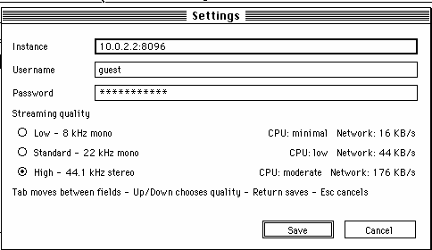

# Jellyfin 68K

A native music client for classic 68K Macintosh computers, built with
[Retro68](https://github.com/autc04/Retro68). It signs in to
[Jellyfin](https://jellyfin.org/), lists the music library, and asks the
server to transcode to **raw 16-bit PCM**. A Settings menu lets you change
the server, username, password, and streaming quality; the presets run from
8 kHz mono (16 KB/s) to 44.1 kHz stereo (176 KB/s). The client does no MP3
decoding at all: PCM is streamed straight into the Sound Manager, so an
FPU-less 68LC040 only has to copy 16-176 KB/s. The complete track is never
held in memory.

The interface is sized for the 512x342 display of a Macintosh Classic
(a 504x296 content area with twelve list rows). Drawing is done in place,
row by row, and the event loop sleeps when there is nothing to do. The library can be sorted by album artist, artist,
album, or title, and searched by song, artist, album artist, or album. A
search first filters the loaded tracks locally, then queries the Jellyfin
server so matches beyond the 400-track window are found too. The client
talks to Jellyfin **over plain HTTP only**.


## What works

Tested against a live Jellyfin `10.11.11` server (`SWAGFLIX`) from System
7.5.3 in Basilisk II at 512x342:

- Login over `POST /Users/AuthenticateByName` with `X-Emby-Authorization`
- Fetch and display 400 audio tracks from `/Users/{id}/Items`
- Sort by **Album Artist** (default), Artist, Album, or Title with `Tab`
- Search by song, artist, album artist, or album with `/`; local filtering is
  instant and a server-wide search finds matches beyond the loaded 400 tracks
- Change the instance, username, password, and streaming quality from
  **Settings → Preferences...** (`Cmd-,`); changes are saved to the config file
- Choose Low, Standard, or High quality; the Settings window shows the CPU
  and network cost of each preset
- Select, scroll, refresh, stop, and quit from the keyboard (or click rows)
- Request a track with Jellyfin's `/Audio/{id}/universal` transcoder
- Stream the chunked PCM response while it arrives and start playback after
  about 1.5 seconds are buffered
- Feed the Sound Manager's double buffer directly from a small PCM ring;
  there is no MP3 decode and no full-track buffer
- Show elapsed/total time and an in-place progress bar while playing
- Re-login and reload the library with `R` or **File → Reload Library**

## How it works

1. The app sends a login request over HTTP.
2. It fetches audio items with
   `Recursive=true&IncludeItemTypes=Audio`.
3. For playback it builds this request. The three quality-dependent values
   come from the Settings preset:

   ```text
   GET /Audio/{itemId}/universal
       ?UserId={userId}
       &DeviceId=jellyfin68k-01
       &MaxStreamingBitrate={128000|352800|1411200}
       &Container=wav
       &AudioCodec=pcm_s16be
       &MaxAudioChannels={1|2}
       &MaxAudioSampleRate={8000|22050|44100}
       &TranscodingContainer=wav
       &TranscodingProtocol=http
       &EnableRedirection=false
   ```

   `MaxAudioSampleRate` and `MaxAudioChannels` make ffmpeg produce the
   requested format. `pcm_s16be` is native big-endian, 16-bit signed PCM,
   which is exactly the format the Sound Manager consumes. The stream is
   16 KB/s at Low, 44 KB/s at Standard, and 176 KB/s at High.

4. The response is chunked and has no `Content-Length`. The client parses
   the chunked transfer encoding itself as data arrives. A 4-second ring
   buffer (64 KB at Low, 176 KB at Standard, 706 KB at High) decouples the
   network from playback and TCP backpressure stops the download if the ring
   is full; the complete PCM is never held in memory. No temporary MP3, PCM,
   or AIFF file is written.
5. After about 1.5 seconds are buffered, `SndPlayDoubleBuffer` starts. Its
   doubleback procedure copies PCM from the ring into the Sound Manager's
   two 500 ms buffers at interrupt time. The main loop pumps the HTTP body in
   small pieces per pass and only redraws the changing footer line.
6. Sorting runs locally over the loaded 400 tracks. The sorted order is
   built once when the library loads or the sort mode changes; typing in the
   search box only filters that order, so each keystroke is O(n) instead of a
   full re-sort. After a short pause, a query of two or more characters is
   also sent to Jellyfin's `SearchTerm` endpoint, so artist, album, and title
   matches from the whole library replace the local result set (up to 400
   results). One-character queries stay local.

Nothing in the client constructs an `https://` URL. The server address is an
IP/host and port, and every request is plain HTTP.

## Requirements

- **Retro68 toolchain**, normally run through Docker:
  `ghcr.io/autc04/retro68:latest`
- **Basilisk II** for testing, plus a 68K Mac ROM and System 7 image
- **MacTCP 2.0.6** for 68K networking (the client uses the `.IPP` driver)
- **Jellyfin** reachable at an HTTP port (8096 by default)
- Sound enabled in the emulator (`MAC_SOUND=1`, the default)

The MacTCP disks are Apple software and are not included here. The client
also works on real hardware with MacTCP, provided the Mac can reach the
server over the LAN.

The UI is designed for a 512x342 mono display (Macintosh Classic, SE/30,
LC, Quadra 605 and similar). It needs no FPU: the only audio work on the Mac
is the PCM ring copy. Memory use is modest too: about 768 KB for the JSON
library, a 64-706 KB PCM ring depending on quality, about 176 KB for the
largest Sound Manager double buffer, and the usual application/system
overhead.

## Build

```sh
make build
```

The primary outputs are:

| File | Purpose |
| --- | --- |
| `build/Jellyfin68K.dsk` | 800 KB HFS disk for Basilisk II or a real Mac |
| `build/Jellyfin68K.bin` | MacBinary II file for transferring to a real Mac |
| `build/Jellyfin68K.APPL` + `build/.rsrc/Jellyfin68K.APPL` | Data and resource forks on Linux |
| `build/Jellyfin68K.code.bin` | Raw executable before Rez packaging |

Several small diagnostic applications are built too (`NetProbe`, `NetTest`,
`MP3Test`, `VolDump`, `LaunchJF`, and the original `Hello68K` sample). They
are optional; only `Jellyfin68K` is the client.

## Configuration

The client looks for `Jellyfin68K.cfg` in this order:

1. `Unix:Jellyfin68K.cfg` — the shared folder in the emulator
2. `Jellyfin68K.cfg` — relative to the app/current directory
3. `System Folder:Preferences:Jellyfin68K.cfg`

Format:

```ini
# comments are allowed
host=10.0.1.1
port=8096
user=guest
pass=your-password
quality=standard
```

`quality` accepts `low` (8 kHz mono), `standard` (22 kHz mono), or `high`
(44.1 kHz stereo). If the key is missing, `standard` is used.

The **Settings → Preferences...** window edits all of these values and writes
them back to the config file that was loaded. If no file was found, it tries
`Unix:Jellyfin68K.cfg` first, then a config file next to the app, then
`System Folder:Preferences`. The instance field accepts `host`, `host:port`,
or an `http://host:port` URL; HTTPS is rejected because the client is
HTTP-only. Changing the instance or credentials saves the file and
immediately signs in again and reloads the library. Changing only the
quality applies to the next track.

If no file is found, the compiled defaults are used:
`10.0.1.1:8096`, user `guest`, password `bomboclat27`, quality `standard`.

For the emulator, `make run` creates `shared/Jellyfin68K.cfg` from
`examples/Jellyfin68K.cfg` on first run. It uses `host=10.0.2.2` because the
emulator reaches the host-side relay through slirp.

For a real Mac on the same LAN as Jellyfin, use
`examples/Jellyfin68K.lan.cfg` (`host=10.0.1.1`) or edit the config file to
match your server.

## Settings and streaming quality



Open **Settings → Preferences...** or press `Cmd-,`. The window edits the
instance, username, and password, and lets you pick one of three quality
presets. The CPU and network cost is shown next to each preset; the table
also lists the PCM ring size:

| Preset | Format | Network | CPU | PCM ring |
| --- | --- | --- | --- | --- |
| Low | 8 kHz mono, 16-bit | 16 KB/s | minimal | 64 KB |
| Standard | 22.05 kHz mono, 16-bit | 44 KB/s | low | 176 KB |
| High | 44.1 kHz stereo, 16-bit | 176 KB/s | moderate | 706 KB |

Standard is the default. The stream is always raw 16-bit big-endian PCM, so
the Mac never decodes MP3. Higher presets only increase the number of bytes
copied into the Sound Manager; they do not add floating-point work.

`Tab` moves between the three text fields and the quality list, `Up`/`Down`
chooses a preset, `Return` saves, and `Esc` cancels. The Save button writes
the config file; if the file or volume is read-only, the window reports the
error instead of silently losing the change. Changing the instance,
username, or password signs in again and reloads the library. Changing only
the quality takes effect on the next track.

## Emulator setup (tested)

### 1. Install and configure MacTCP

Install the MacTCP 2.0.6 control panel into the working system image. The
helper script accepts either the original MacTCP disk image or a MacBinary
copy of the `MacTCP` cdev:

```sh
make build
scripts/install-mactcp.sh /path/to/MacTCP.dsk
```

It patches the saved driver configuration to:

- IP `10.0.2.15`
- subnet mask `255.0.0.0`
- DNS `10.0.2.3`

and installs MacTCP in both `Control Panels` and `Startup Items`. You can
override the values with `MACTCP_IP`, `MACTCP_MASK`, and `MACTCP_DNS`.
If `.state/system.img` does not exist yet, the script creates it from
`images/system.img`.

The working system image is now preserved between `make run` calls, including
MacTCP. To discard all Mac-side changes and start over, run
`make reset-state`. Run it after replacing `images/system.img` as well.

The MacTCP control panel opens automatically at boot. **Open and close it
once after each boot** (or just close the window that opens) so it installs
the `.IPP` driver. The client reports this if it is launched too early:

```text
MacTCP .IPP not open - open MacTCP, close it, relaunch
```

### 2. Start the relay

Basilisk II uses slirp. The guest is `10.0.2.15`, the slirp gateway is
`10.0.2.2`, and slirp only answers for its own `10.0.2.x` addresses. The
Jellyfin server on this LAN is at `10.0.1.1`, so the guest cannot route to
it directly with the default `255.0.0.0` mask.

The relay is a transparent TCP pipe. It does not change HTTP or transcoding;
Jellyfin still receives the normal HTTP requests and produces the PCM
stream.

In one terminal:

```sh
make relay
# relay listening on 0.0.0.0:8096 -> 10.0.1.1:8096
```

In another terminal:

```sh
make run
```

`make run` creates `shared/Jellyfin68K.cfg` with `host=10.0.2.2` on first
use.

### 3. Launch the client

Boot System 7, close the MacTCP control panel window once, then open the
`Jellyfin68K` volume and double-click **Jellyfin68K**. If the emulator is
using the default config, open **Settings → Preferences...** (`Cmd-,`) to
change the instance, credentials, or quality without editing the file.

If the app volume icon does not appear on the desktop, the Finder's
"Show hard disks" preference may be off. Open **Control Panels → Views** and
enable hard disks, or use the included `LaunchJF` diagnostic (it waits 20
seconds and then launches `Jellyfin68K` from a mounted volume by path). The
volume is mounted even when the icon is hidden; `VolDump` confirms this.

### Sound

`configure-emulator.sh` enables Sound Manager audio by default
(`nosound false`). With `MAC_SOUND=0` you will get error `-200` from
`SndNewChannel`, and playback will not start.

The emulator defaults to a 512x342 screen so the layout can be checked at
the target size. Use `MAC_SCREEN=1024x768 make run` for a larger desktop; the
client window stays compact and centered. To exercise the FPU-less
68LC040 path, run `MAC_FPU=0 make run`; the client itself uses no
floating point.

## Real 68K Mac

1. Copy `build/Jellyfin68K.dsk` or `build/Jellyfin68K.bin` to the Mac.
2. Install/configure MacTCP for the LAN (Ethernet, IP on the Jellyfin
   network, gateway/DNS as needed).
3. Put `Jellyfin68K.cfg` next to the app or in
   `System Folder:Preferences`, with `host` set to the Jellyfin server.
4. Launch the app. No relay is needed on a real LAN.

The transcode request and the HTTP-only behavior are identical on hardware.

## Controls

| Key | Action |
| --- | --- |
| Up / Down | Move through the track list |
| Home / End | Jump to the first or last match |
| Page Up / Page Down | Scroll one screen |
| Return, Enter, or Space | Play the selected track |
| `/` | Focus the search box |
| Type | Filter by title, artist, album artist, or album |
| Backspace | Delete the last search character |
| Escape | Clear the search and leave the field |
| Tab | Cycle sort order: Album Artist, Artist, Album, Title |
| `S` | Stop playback |
| `R` | Re-login and reload the library (stops playback) |
| `Cmd-,` | Open **Settings → Preferences...** |
| `Cmd-R` | Reload the library (same as `R`) |
| `Cmd-Q` | Quit |
| `Q` | Quit |
| Click a row | Select it |
| Double-click a row | Select and play it |

The top row shows the library status on the left and the number of matching
tracks on the right (for example `15/400`). Below it are the search box and
the sort control. While a track is playing, the footer shows elapsed and
total time plus a progress bar.

Typing one character filters the loaded 400 tracks locally. After a short
pause, a query of two or more characters also searches the whole Jellyfin
library through the server's `SearchTerm` endpoint, so artist, album, and
title matches that are not in the loaded window appear too. Up to 400 server
results are shown; `Escape` clears the search and restores the loaded
library.

## Verified test results

The test server is Jellyfin `10.11.11` (`SWAGFLIX`) at `10.0.1.1:8096`.
The emulator connects through `10.0.2.2:8096` and the relay.

```text
Login HttpOpen: 0
Login status: 200
Login body bytes: 3367
Login token parse: 0
Library status: 200
Library body bytes: 326065
Tracks parsed: 400
Audio HttpOpen: 0
Audio header read: 0
Audio status: 200
Search status: 200
Search body bytes: 659
Search tracks parsed: 1
```

The UI was tested at 512x342. The Settings window opened with `Cmd-,`, a
quality change was saved, and `shared/Jellyfin68K.cfg` was rewritten with the
new preset. Selecting High produced a request for `MaxAudioSampleRate=44100`,
`MaxAudioChannels=2`, and `MaxStreamingBitrate=1411200`; the footer advanced
normally. A server-wide search returned a Radiohead track outside the
400 loaded items. In the earlier 8 kHz mono test, the selected track was
1tbsp — "City Affirmations" (31 seconds); playback started after about 1.5
seconds were buffered, the footer advanced from `0:01` to `0:31`, and the
client then displayed `Finished: 1tbsp - City Affirmations`. A 3:17 track was
also streamed and played in real time. Host-side PulseAudio monitor capture
confirmed that the Sound Manager double buffer produced non-silent output,
and the emulator's idle/playback CPU difference was only a few percent.

## Troubleshooting

**MacTCP `.IPP` error / `HttpOpen: -23`**

Open **Control Panels → MacTCP** and close the window once. The driver is
installed when the control panel closes. Then press `R` to retry, or relaunch
the client.

**Relay connection fails**

- Is `make relay` running?
- Does `shared/Jellyfin68K.cfg` contain `host=10.0.2.2`?
- Can the host reach Jellyfin? `curl http://10.0.1.1:8096/System/Info/Public`
- Check the relay output for `connection ... -> 10.0.1.1:8096`.

**Sound Manager `-200`**

`nosound true` is set in the Basilisk II prefs, so the Sound Manager has no
hardware. Regenerate the prefs with `MAC_SOUND=1 make run`, or edit
`.state/BasiliskII.prefs` to `nosound false` and restart the emulator.

**Login fails**

Open **Settings → Preferences...** (`Cmd-,`) and check the instance,
username, and password. The instance must be an HTTP host or `host:port`;
`https://` is rejected. The server must be reachable over plain HTTP. A
Jellyfin server that only listens on HTTPS will not work with this client,
by design. The same values can be edited in `Jellyfin68K.cfg`.

**Settings cannot be saved**

The client writes to the config file it loaded, or to
`Unix:Jellyfin68K.cfg` / `System Folder:Preferences:Jellyfin68K.cfg` if no
file was loaded. Make sure that volume is not locked or read-only. The
Settings window shows `Could not write the config file` and stays open if
the write fails.

**Server search finds nothing**

A query needs at least two characters and a working HTTP connection; the
status line reports `Search server unreachable` or the HTTP status. Clear
the search with `Escape` to return to the loaded 400 tracks. Search results
are capped at 400, like the initial library load.

**App disk icon is missing**

The volume can still be mounted. Check with `VolDump`, enable hard disks in
Control Panels → Views, or use `LaunchJF`. On a real Mac, mount the `.dsk`
directly or copy the `.bin` with a MacBinary-aware tool.

**Build errors**

Run `make doctor`. If Docker is unavailable, install Retro68 natively and
set `RETRO68_TOOLCHAIN` to the toolchain directory.

## Project layout

```text
app/
  jellyfin.c        UI (sort/search/settings), menus, login, library, playback
  http.c/.h         MacTCP HTTP client with chunked transfer decoding
  json.c/.h         Generic JSON parser + streaming Jellyfin items parser
  audio.c/.h        PCM ring buffer, double-buffered Sound Manager playback
  minimp3.h         Vendored decoder for the MP3Test diagnostic only
  mactcp/           MacTCP helper routines (Retro68-compatible)
  *.r               Rez SIZE resources

scripts/
  build.sh                 Retro68/Docker build
  configure-emulator.sh    Basilisk II prefs and app disk
  run.sh                   build + boot helper
  jellyfin-relay.py        slirp TCP relay for the emulator
  install-mactcp.sh        install/patch MacTCP 2.0.6 in .state/system.img
  doctor.sh, setup.sh      environment checks/setup

examples/
  Jellyfin68K.cfg          emulator config (host 10.0.2.2)
  Jellyfin68K.lan.cfg      real-LAN config (host 10.0.1.1)

docs/jellyfin68k.png       main window screenshot
docs/settings.png          settings window screenshot
shared/                    the Mac's "Unix" volume
```

## Diagnostics

These are built alongside the client and are useful when bringing up a new
emulator:

- **NetProbe** — headless MacTCP GET of `/System/Info/Public`; writes
  `Unix:netprobe.txt`. Useful for checking `.IPP`, the relay, and HTTP.
- **NetTest** — windowed version of the same probe.
- **MP3Test** — decodes `Unix:test.mp3` to `Unix:test.aiff`, logs decode
  timing to `Unix:mp3log.txt`, and tests `SndStartFilePlay`.
- **VolDump** — writes mounted volume names/refNums to `Unix:voldump.txt`.
- **LaunchJF** — waits 20 seconds, then launches `Jellyfin68K` from a mounted
  app volume by path. Used when a Finder desktop icon is hidden.
- **Hello68K** — the original Retro68 sample application.

## Limitations

- Playback starts after roughly 1.5 seconds of PCM has been buffered, then
  follows the network. The server transcodes much faster than real time in
  testing, so the 4-second ring stays full.
- The UI is deliberately compact (about 500x300 content) for a 512x342
  display. It does not scale up or add columns on larger screens.
- Stop is supported; pause and seek are not.
- The initial library request is capped at 400 tracks. Server-wide search
  can find tracks outside that window, but it also shows at most 400 results.
- A two-or-more-character search makes a synchronous HTTP request after a
  short pause. On a slow network this can briefly delay audio buffering.
- No album art.
- Non-ASCII track/artist names are converted to ASCII, with unknown
  characters shown as `?`.
- Credentials are sent in clear text because the client is HTTP-only, as
  requested. Use it only on a trusted network.
- MacTCP configuration is manual (or via the helper script) and is specific
  to the MacTCP 2.0.6 driver layout.

## Credits

- [Retro68](https://github.com/autc04/Retro68) — 68K cross-compiler and
  application packaging.
- [Basilisk II](https://github.com/kanjitalk755/macemu) — emulator.
- [minimp3](https://github.com/lieff/minimp3) — public-domain/MIT-licensed
  MP3 decoder, used only by the `MP3Test` diagnostic.
- MacTCPHelper (based on Apple sample code, modified for Retro68) —
  MacTCP stream helpers.
- [Jellyfin](https://jellyfin.org/) — media server and transcoder.

MacTCP and System 7 are Apple software and are not distributed with this
project.
