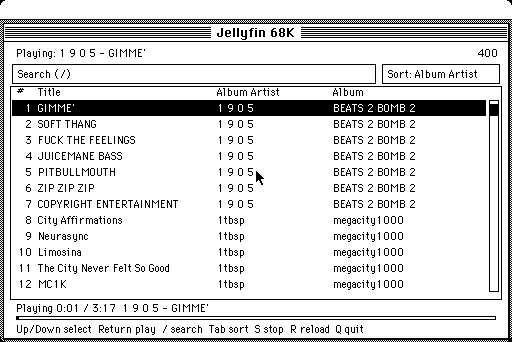

# Jellyfin 68K

A native music client for classic 68K Macintosh computers, built with
[Retro68](https://github.com/autc04/Retro68). It signs in to
[Jellyfin](https://jellyfin.org/), lists the music library, and asks the
server to transcode to **raw 16-bit PCM at 8 kHz mono**. The client does no
MP3 decoding at all: PCM is streamed straight into the Sound Manager, so an
FPU-less 68LC040 only has to copy about 16 KB/s. The complete track is never
held in memory.

The interface is sized for the 512x342 display of a Macintosh Classic
(a 504x296 content area with twelve list rows). Drawing is done in place,
row by row, and the event loop sleeps when there is nothing to do. The
library can be sorted by album artist, artist, album, or title, and searched
by song name. The client talks to Jellyfin **over plain HTTP only**.



## What works

Tested against a live Jellyfin `10.11.11` server from System 7.5.3 in
Basilisk II at 512x342:

- Login over `POST /Users/AuthenticateByName` with `X-Emby-Authorization`
- Fetch and display 400 audio tracks from `/Users/{id}/Items`
- Sort by **Album Artist** (default), Artist, Album, or Title with `Tab`
- Search the loaded library by song, artist, album artist, or album with `/`
- Select, scroll, refresh, stop, and quit from the keyboard (or click rows)
- Request a track with Jellyfin's `/Audio/{id}/universal` transcoder
- Stream the chunked PCM response while it arrives and start playback after
  about 1.5 seconds are buffered
- Feed the Sound Manager's double buffer directly from a small PCM ring;
  there is no MP3 decode and no full-track buffer
- Show elapsed/total time and an in-place progress bar while playing
- Re-login and reload the library with `R`

## How it works

1. The app sends a login request over HTTP.
2. It fetches audio items with
   `Recursive=true&IncludeItemTypes=Audio`.
3. For playback it builds this request (all values are fixed in the client):

   ```text
   GET /Audio/{itemId}/universal
       ?UserId={userId}
       &DeviceId=jellyfin68k-01
       &MaxStreamingBitrate=128000
       &Container=wav
       &AudioCodec=pcm_s16be
       &MaxAudioChannels=1
       &MaxAudioSampleRate=8000
       &TranscodingContainer=wav
       &TranscodingProtocol=http
       &EnableRedirection=false
   ```

   `MaxAudioSampleRate` and `MaxAudioChannels` make ffmpeg produce 8000 Hz
   mono. `pcm_s16be` is native big-endian, 16-bit signed PCM, which is
   exactly the format the Sound Manager consumes. The stream is 16 KB/s,
   or about 1.4 MB for an 87-second track.

4. The response is chunked and has no `Content-Length`. The client parses
   the chunked transfer encoding itself as data arrives. A small 4-second
   ring buffer decouples the network from playback and TCP backpressure
   stops the download if the ring is full; the complete PCM is never held in
   memory. No temporary MP3, PCM, or AIFF file is written.
5. After about 1.5 seconds are buffered, `SndPlayDoubleBuffer` starts. Its
   doubleback procedure copies PCM from the ring into the Sound Manager's
   two 500 ms buffers at interrupt time. The main loop pumps the HTTP body in
   small pieces per pass and only redraws the changing footer line.
6. Sorting and search run locally over the loaded 400 tracks. The sorted
   order is built once when the library loads or the sort mode changes;
   typing in the search box only filters that order, so each keystroke is
   O(n) instead of a full re-sort.

Nothing in the client constructs an `https://` URL. The server address is an
IP and port, and every request is plain HTTP.

## Requirements

- **Retro68 toolchain**, normally run through Docker:
  `ghcr.io/autc04/retro68:latest`
- A 68K Mac (or emulator) running System 7 with **MacTCP 2.0.6**
- **Jellyfin** reachable at an HTTP port (8096 by default)
- Sound enabled on the Mac

The client works on real hardware with MacTCP, provided the Mac can reach
the server over the LAN. The UI is designed for a 512x342 mono display
(Macintosh Classic, SE/30, LC, Quadra 605 and similar). It needs no FPU: the
only audio work on the Mac is the PCM ring copy. Memory use is modest too:
about 768 KB for the JSON library, 64 KB for the PCM ring, and the usual
application/system overhead.

## Build

```sh
make build
```

Docker is used by default. To build with a native Retro68 installation:

```sh
RETRO68_TOOLCHAIN=/path/to/Retro68-build/toolchain make build
```

The build produces:

| File | Purpose |
| --- | --- |
| `build/Jellyfin68K.bin` | MacBinary II file for transferring to a real Mac |
| `build/Jellyfin68K.dsk` | 800 KB HFS disk for an emulator or a real Mac |
| `build/Jellyfin68K.APPL` + `build/.rsrc/Jellyfin68K.APPL` | Data and resource forks on Linux |
| `build/Jellyfin68K.code.bin` | Raw executable before Rez packaging |

## Install on a real Mac

1. Download `Jellyfin68K.bin` from the
   [latest release](../../releases/latest), or build it yourself.
2. Copy it to the Mac with a MacBinary-aware tool.
3. Install and configure MacTCP 2.0.6 (Ethernet, IP on the Jellyfin network,
   gateway/DNS as needed).
4. Put `Jellyfin68K.cfg` next to the app or in
   `System Folder:Preferences`, with `host` set to the Jellyfin server.
5. Launch the app.

No relay or host-side service is needed on a real LAN.

## Configuration

The client looks for `Jellyfin68K.cfg` in this order:

1. `Unix:Jellyfin68K.cfg` — the shared folder in an emulator
2. `Jellyfin68K.cfg` — relative to the app/current directory
3. `System Folder:Preferences:Jellyfin68K.cfg`

Format:

```ini
# comments are allowed
host=10.0.1.1
port=8096
user=guest
pass=your-password
```

If no file is found, the compiled defaults are used:
`10.0.1.1:8096`, user `guest`, and an empty password.

The server must be reachable over HTTP; a Jellyfin server that only listens
on HTTPS will not work with this client, by design.

## Controls

| Key | Action |
| --- | --- |
| Up / Down | Move through the track list |
| Home / End | Jump to the first or last match |
| Page Up / Page Down | Scroll one screen |
| Return, Enter, or Space | Play the selected track |
| `/` | Focus the search box |
| Type | Filter by song, artist, album artist, or album |
| Backspace | Delete the last search character |
| Escape | Clear the search and leave the field |
| Tab | Cycle sort order: Album Artist, Artist, Album, Title |
| `S` | Stop playback |
| `R` | Re-login and reload the library (stops playback) |
| `Q` | Quit |
| Click a row | Select it |
| Double-click a row | Select and play it |

The top row shows the library status on the left and the number of matching
tracks on the right (for example `15/400`). Below it are the search box and
the sort control. While a track is playing, the footer shows elapsed and
total time plus a progress bar.

The search runs over the tracks that were loaded from the server (up to 400).
It does not issue a new server-wide search request.

## Troubleshooting

**MacTCP `.IPP` error / `HttpOpen: -23`**

Open **Control Panels → MacTCP** and close the window once. The driver is
installed when the control panel closes. Then press `R` to retry, or relaunch
the client.

**Login fails**

Check `host`, `port`, `user`, and `pass` in `Jellyfin68K.cfg`. The server
must be reachable over HTTP. A Jellyfin server that only listens on HTTPS
will not work with this client, by design.

**Sound Manager `-200`**

The Sound Manager has no audio hardware. Enable sound in the emulator or on
the Mac. With `nosound true` in Basilisk II you will get error `-200` from
`SndNewChannel`, and playback will not start.

## Limitations

- Playback starts after roughly 1.5 seconds of PCM has been buffered, then
  follows the network. The server transcodes much faster than real time in
  testing, so the 4-second ring stays full.
- The UI is deliberately compact (about 500x300 content) for a 512x342
  display. It does not scale up or add columns on larger screens.
- Stop is supported; pause and seek are not.
- The library request is capped at 400 tracks, and search only covers those
  loaded tracks.
- No album art.
- Non-ASCII track/artist names are converted to ASCII, with unknown
  characters shown as `?`.
- Credentials are sent in clear text because the client is HTTP-only. Use it
  only on a trusted network.
- MacTCP configuration is manual and is specific to the MacTCP 2.0.6 driver
  layout.

## Project layout

```text
src/
  jellyfin.c        UI (sort/search), login, library, playback orchestration
  http.c/.h         MacTCP HTTP client with chunked transfer decoding
  json.c/.h         Generic JSON parser + streaming Jellyfin items parser
  audio.c/.h        PCM ring buffer, double-buffered Sound Manager playback
  mactcp/           MacTCP helper routines (Retro68-compatible)
  jellyfin.r        Rez SIZE resource

scripts/build.sh    Retro68/Docker build
examples/           sample configuration
docs/               screenshot
```

## Credits

- [Retro68](https://github.com/autc04/Retro68) — 68K cross-compiler and
  application packaging.
- [Basilisk II](https://github.com/kanjitalk755/macemu) — emulator used for
  testing.
- MacTCPHelper (based on Apple sample code, modified for Retro68) —
  MacTCP stream helpers.
- [Jellyfin](https://jellyfin.org/) — media server and transcoder.

MacTCP and System 7 are Apple software and are not distributed with this
project.
